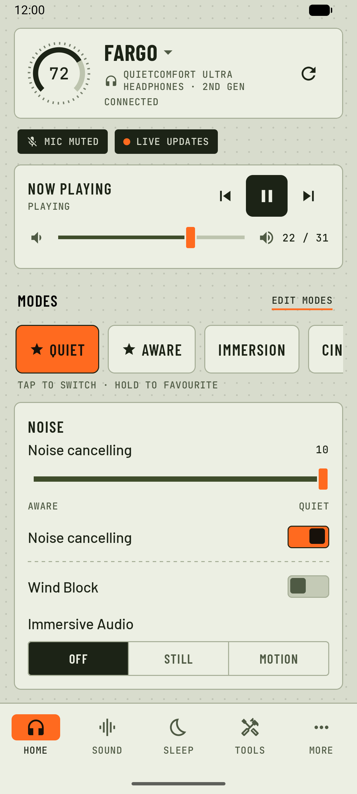
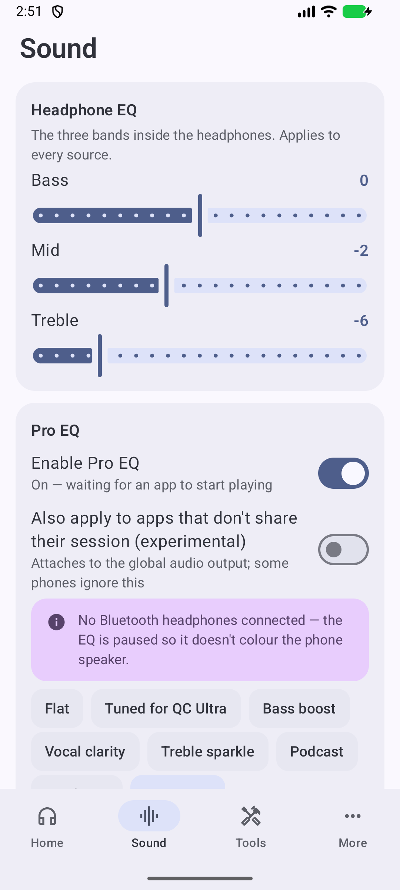
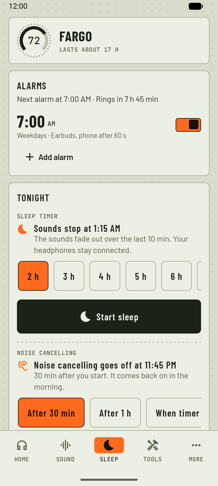
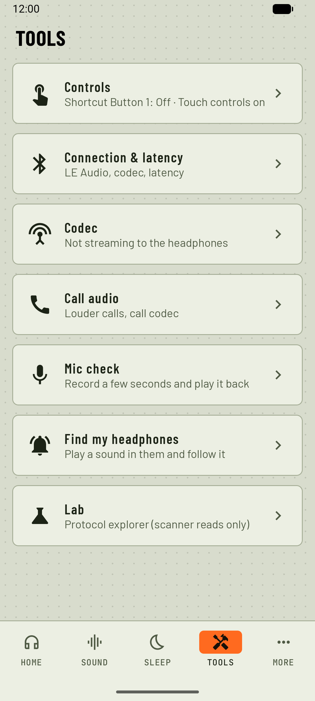

# Earshot

**One Android app for your Bluetooth headset, whatever the brand.** No account, no cloud, no
analytics, no internet permission.

  
  
  
  

## What it does

- **Any headset:** battery, a Pro EQ with a preset per headset (AutoEq import, volume boost), a
  codec panel, louder calls, a mic check, button remapping, automations, a Quick Settings tile, a
  widget, and a universal remote to connect, disconnect, rename and forget it.
- **Sleep** (new in 0.9): a 15 min to 6 h sleep timer with real rain, ocean and fire recordings,
  noise or your own sounds; noise cancelling off for the night; and wake-up alarms in the earbuds,
  on the phone or both, with the phone as a safety net.
- **Supported headsets** also get their own controls: noise modes, the headset's EQ, buttons and
  settings, straight over Bluetooth on the maker's own protocol.
- **Open and careful:** a read-only Lab scanner and a connection report for every supported brand;
  firmware updates, factory resets and unpairing are never sent.

## Supported headsets

| Brand | Status | Models |
|---|---|---|
| **Bose** | QC Ultra Headphones (2nd Gen) tested; others experimental | QC Ultra Headphones and Earbuds, QC Headphones, QC SC, QC45, QC SE, QC Earbuds II, Ultra Open Earbuds; basic: QC Earbuds (2020), NC 700 |
| **Soundcore** | Sleep A30 tested; 35 models experimental | Liberty 3 Pro / 4 / 4 NC / 5, P31i, P40i, R50i NC, R60i NC, A30i, Space A40 / One / One Pro / Q45 / 2 and more |
| **Sennheiser** | Experimental | MOMENTUM 4 / 5, ACCENTUM / Plus / TW, MOMENTUM True Wireless 3 / 4, MOMENTUM Sport |
| **Sony** | Experimental | WH-1000XM5 / XM6, WF-1000XM4 / XM5 / XM6, LinkBuds, ULT WEAR, WH-CH720N, WF-C510 / C700N / C710N |
| **Skullcandy** | Experimental | Crusher 1080 ANC, Method 360 ANC, Method 540 ANC |
| **JBL** | Experimental | 2021–24 models over Bluetooth LE: Wave / Vibe / Tune Buds 2 and Flex 2, Tune Flex / Beam / Buds, Live Pro 2, Live 660 / 770NC, Tour One M2, Tour Pro 2 and more |
| **AirPods, Beats** | Battery only | Left, right and case battery |
| **Everything else** | Any-headset features | Shown by its own name; nothing is sent to it |

Experimental means built from protocol research and tested against a virtual headset, not yet on
real hardware. Reports are very welcome: open an issue with **Tools → Lab → Copy connection report**.
Per-model details, requirements and limitations: [docs/supported-headsets.md](docs/supported-headsets.md).

## Install

Download `earshot-<version>.apk` from [Releases](../../releases) and open it on your phone
(Android 9 or newer). Close the maker's app while Earshot controls that headset: only one app can
hold its control channel. [Shizuku](https://shizuku.rikka.app/) is optional (codec switching).
No headset at hand? **Try demo mode** on the welcome screen.

Build it yourself: `./gradlew assembleDebug` (Windows: `.\gw.cmd assembleDebug`).

What changed: [CHANGELOG.md](CHANGELOG.md) · Plans: [docs/roadmap.md](docs/roadmap.md) ·
Protocol research: [docs/research/](docs/research/)

## Credits

Protocol knowledge builds on these MIT-licensed projects: [bosectl](https://github.com/aaronsb/bosectl),
[Quiet Rebellion](https://github.com/MadEyez/quietrebellion), [soundcorebridge](https://github.com/mervin008/soundcorebridge),
[momentum4-control](https://github.com/Ariazonaa/momentum4-control), [momentumctl](https://codeberg.org/galen/momentumctl),
[SonyHeadphonesClient](https://github.com/mos9527/SonyHeadphonesClient), [jbl-control](https://github.com/AhmadRun/jbl-control), and
[AutoEq](https://github.com/jaakkopasanen/AutoEq) for the correction curves. OpenSCQ30 (GPL-3.0) and
Gadgetbridge (AGPL-3.0) were read for protocol facts only. Fonts: Barlow and JetBrains Mono (SIL OFL
1.1). Sleep sounds: public-domain field recordings from [radio aporee ::: maps](https://aporee.org/maps/)
(recordists named in the app's About screen and in `tools/sleep-sounds/sources.json`). Reference
copies and licences: `docs/reference/`.

## Not affiliated

Earshot is not affiliated with, endorsed by or supported by Bose, Apple, Skullcandy, Anker
(Soundcore), Sony, Sennheiser, JBL (Harman) or any other headphone maker. Bose and QuietComfort are trademarks of
Bose Corporation; AirPods and Beats of Apple Inc.; Skullcandy and Crusher of Skullcandy, Inc.;
Anker and Soundcore of Anker Innovations Limited; Sony of Sony Group Corporation; Sennheiser of
Sennheiser electronic SE & Co. KG; JBL of Harman International Industries. Other names belong to their owners.

## Licence

MIT. See `LICENSE`.
