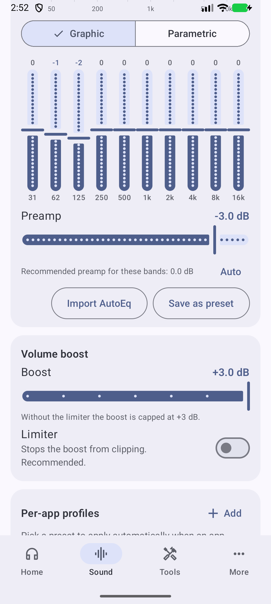
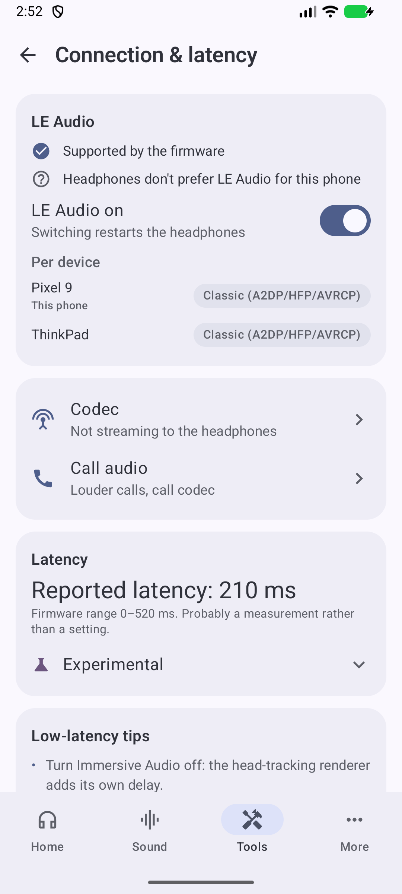
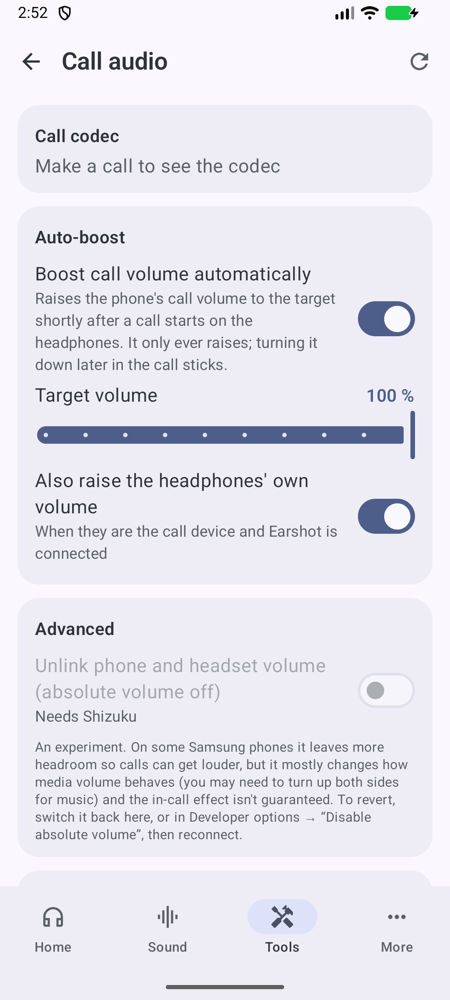
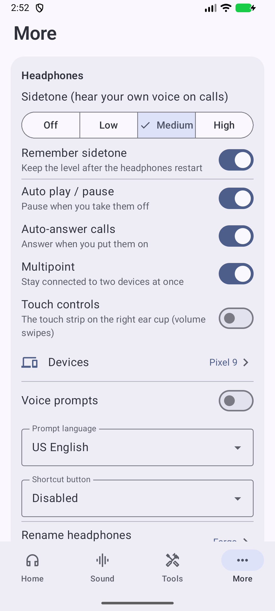
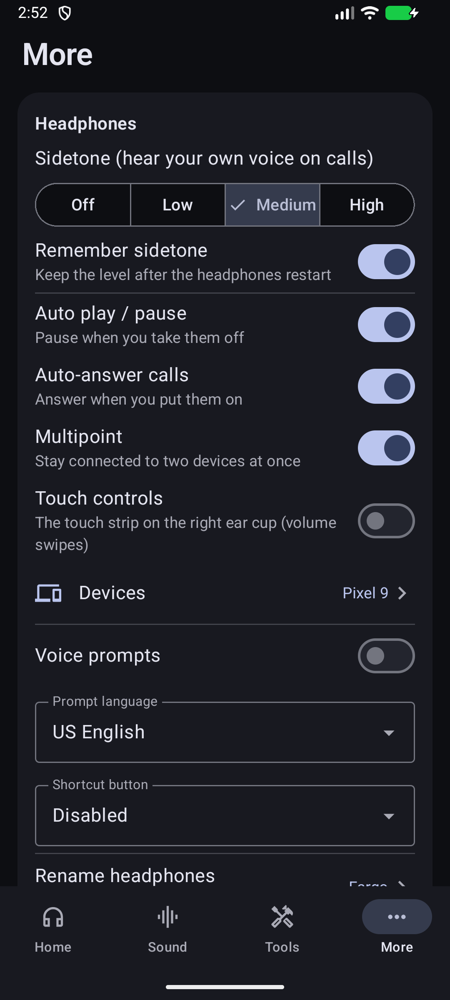
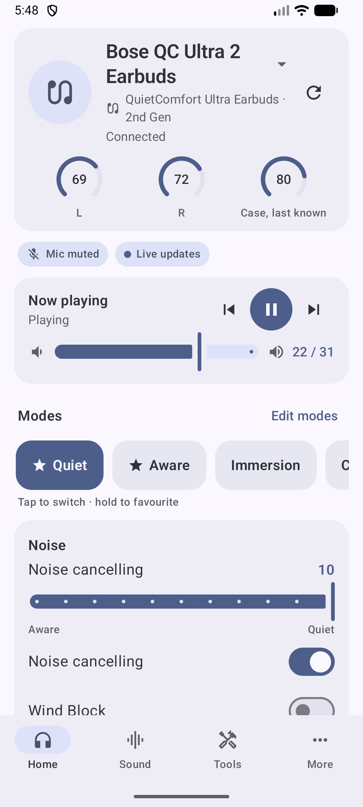
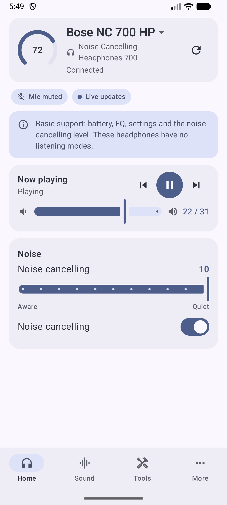
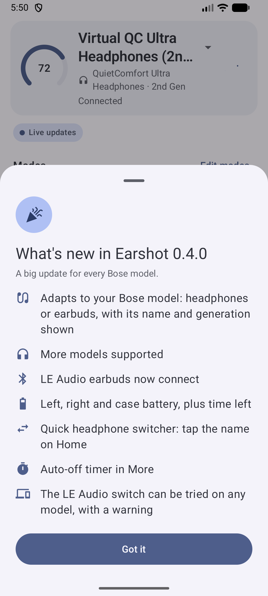

# Earshot

**One Android app for your Bluetooth headset, whatever the brand.** No account, no cloud, no
analytics, **no internet permission at all**. Earshot is the companion app for people who don't
like the maker's app, or are tired of one app per brand.

- **Every headset** gets its own name, battery, a pro equaliser (Pro EQ) with a preset per headset,
  a Bluetooth codec panel, louder calls, a mic check, a Controls remapper, automations, a Quick
  Settings tile, a widget and a universal remote (connect, disconnect, rename and forget), all
  through Android itself. See [Any headset](#any-headset).
- **Headsets whose protocol Earshot knows** also get their own controls (noise modes, the
  headset's EQ, buttons, settings): **Bose** (the deepest and best-tested integration), plus
  experimental drivers for **Soundcore**, **Sennheiser**, **Sony** and **Skullcandy**. AirPods and
  Beats show their left, right and case battery. See [Supported headphones](#supported-headphones).

Earshot talks to a supported headset directly over Bluetooth, using the maker's own control
protocol on the same channel the maker's app uses, and sends nothing at all to a headset it has no
driver for. It started as a Bose QC Ultra controller and grew from there.

> Not affiliated with or endorsed by Bose, Apple, Skullcandy, Anker (Soundcore), Sony, Sennheiser
> or any other headphone maker; trademarks are listed [below](#not-affiliated).
> Tested on a Bose QC Ultra Headphones (2nd Gen, firmware 10.x) and one pair of Soundcore Sleep A30.
> Everything else is experimental. What's new: [CHANGELOG.md](CHANGELOG.md).

<p align="center">
  
  
  
  
</p>
<p align="center">
  
  
  
  
</p>

*These screenshots show the look before 0.75 (Bose QC Ultra Headphones). New screenshots, with the
Field theme and the other brands, will follow.*

## New in 0.75

0.75 merges the planned 0.6 and 0.7 releases (0.6 was never released). Full list:
[CHANGELOG.md](CHANGELOG.md).

- **Works with any Bluetooth headset.** An unknown headset appears under its own name, with
  battery, Pro EQ, codec, call audio, Controls and automations. Earshot sends it nothing. Before,
  it treated every unknown headset as a Bose.
- **Universal remote** (Tools → Controls): link a headset once through one Android dialog, no
  re-pairing, and Earshot can connect and disconnect it (Android 17), set the name this phone
  shows (Android 13+) and forget it (Android 16), for any brand.
- **New experimental drivers:** Sennheiser (GAIA v3), Sony (MDR v2), 35 Soundcore models and the
  Skullcandy Method 360 / 540 ANC (on top of the Crusher 1080). Soundcore Sleep A30 is tested on
  one pair.
- **AirPods and Beats:** left, right and case battery and charging from the Bluetooth adverts they
  broadcast. No connection, nothing sent.
- **Battery without Shizuku** on headsets that speak Bluetooth LE (standard Battery Service),
  **codec readout without Shizuku**, and **a Pro EQ preset remembered per headset**.
- **The connected headset is the one shown**, and calls, automations and the background service
  follow the headset's audio link.
- **A new look, "Field",** with olive, sand and ink colours and a safety-orange indicator, and a
  new app icon, "Strike". System colours (Android 12+) stay an option.
- **Fixes:** the call volume boost now reaches the headset; a Bluetooth socket the phone won't let
  go of no longer stalls the connection search ([#1](../../issues/1)); other brands no longer get
  Bose probes.

## Earshot and the makers' apps

Makers' apps differ a lot, so the middle column says what is common. Where a number is given it is
cited.

| | The maker's app (typically) | Earshot |
|---|---|---|
| Account / cloud | Often an account, with settings synced through the maker's servers | None. Nothing leaves the phone (no `INTERNET` permission) |
| Trackers and permissions | Varies. Per Exodus Privacy, October 2026: the Bose app lists 8 trackers, Samsung's Buds plugin requests 102 permissions and Nothing X 92 | No trackers, no analytics; the few permissions are listed under [Requirements](#requirements) |
| Startup | A splash and sign-in or cloud checks before the headset shows | Connected and showing live state in about a second (measured on a Bose QC Ultra 2) |
| Live state | Often polled | Listens for what the headset announces: button presses, mode, noise, battery and volume changes show at once (Bose, Sony, Sennheiser, Soundcore) |
| Equaliser | The maker's own EQ, for its own headsets | Those too, **plus** a 10-band graphic / parametric Pro EQ on any headset: presets, a preset remembered per headset, AutoEq import and a **volume boost** up to +12 dB with a limiter and a hearing-safety guard |
| Codec | Rarely shown; changing it means Developer options | Live codec panel on any headset; **switch AAC ↔ SBC** from the app with Shizuku (no root) |
| Calls | Level and quality left to the phone | **Automatic in-call volume boost** that waits for the call audio to reach the headset, call-codec readout (CVSD / mSBC / LC3), mic check |
| Button remapping | A short list of the maker's actions | **Remap the press-and-hold** of any headset that calls the phone's voice assistant: EQ preset, voice memo, launch an app. **Detect a button** says what each control does |
| Several brands | One app per brand | One app, a device switcher, settings kept per headset |
| Connect / rename / forget | In Android's Bluetooth settings, or the maker's app | **Universal remote** for any brand, from one place (Android 13 / 16 / 17 as above) |
| Quick access | Open the app | **Quick Settings tile**, **home-screen widget**, persistent notification with mode buttons |
| Automation | Rare | Mode or EQ by **Wi-Fi network, app in front, schedule, or on connect**; low-battery alert |
| Transparency | Closed | Open source (MIT), protocol notes in this repo, a read-only **Lab** scanner for each supported stack and a **Copy connection report** |

What stays with the maker's app, on purpose:
- **Firmware updates.** A bad flash from a third-party app isn't worth the risk, and no driver
  ever sends an update command.
- **Anything that needs the maker's servers** (accounts, Sennheiser's Sound Check, Skullcandy's
  Skull AI and Skull-iQ voice control, and the like). Earshot has no internet permission.
- **Settings a model's firmware doesn't let third parties write.** They are shown as such, with a
  message, instead of failing silently.

## Supported headphones

Earshot never opens a control channel blind. It identifies the headset first (by name, by what it
announces, and by the service ID it publishes) and then talks only that brand's protocol, on that
brand's own service. Anything it doesn't recognise is an [any headset](#any-headset).

| Tier | What it means | Who |
|---|---|---|
| **Tested** | Run on our own hardware | Bose QC Ultra Headphones (2nd Gen); Soundcore Sleep A30 (one pair) |
| **Experimental** | Built from published protocol research and a virtual headset, **not yet tried on real hardware**. Earshot reads the state before it writes and checks the result where it can | The other Bose models, Soundcore, Sennheiser, Sony, Skullcandy |
| **Battery only** | Left, right and case battery from the Bluetooth adverts | AirPods, Beats |
| **Any headset** | The Android-level features, nothing sent to the headset | Everything else |

> **Experimental means untested on real hardware. Reports are very welcome:** open an issue with
> what works and what doesn't. Tools → Lab → **Copy connection report** helps most. Demo mode
> (App preferences → Demo mode) shows how each model looks without the headset.

### Bose

Earshot reads the model from the headphones when it connects and, like the Bose app, takes most of
what it shows from what the headphones report: how many built-in and custom modes they have, which
of Wind Block, Immersive Audio and the ANC switch exist, the noise-level steps, the batteries and
which settings answer. A product table only supplies names, form factor and first guesses.
Per-model research: [docs/bose-models.md](docs/bose-models.md).

Everything the Bose app does for daily use is there: your model's listening modes (for example
Quiet / Aware / Immersion / Cinema + 7 custom slots on the QC Ultra 2, favourites), noise-cancelling
level, Wind Block, Immersive Audio, Self Voice (sidetone), auto play/pause, auto-answer, auto-off
timer, voice prompts, multipoint and device switching, pairing mode, shortcut-button action, touch
controls, battery, power off. On top come LE Audio on/off with a result check, latency controls
and the headphones' own 3-band EQ next to the Pro EQ.

| Model | Status | Noise control | Notes |
|---|---|---|---|
| QC Ultra Headphones (2nd Gen) | **Tested** on our hardware | Live | Everything above |
| QC Ultra Headphones (1st Gen) | Reported working by a user (0.3.1) | Live | Built-in Quiet / Aware / Immersion, Wind Block, up to 7 custom modes |
| QC Ultra Earbuds (2nd Gen) | Layout verified by bosectl | Live | Left / right / case battery; Quiet / Aware / Immersion / Cinema |
| QC Ultra Earbuds (1st Gen) | Best guess, checked while connecting | Live, or via the active custom mode | LE Audio connection fixed in 0.4.0 (user report) |
| QC Headphones (2nd Gen) | Best guess, checked while connecting | Live | Quiet / Aware / Immersion / Cinema, Wind Block, ANC off |
| QC Headphones (1st Gen), QC SC | Layout verified by [bosectl](https://github.com/aaronsb/bosectl) | Via the active custom mode | No ANC on/off, no Immersive Audio; built-in Quiet / Aware. Control channel 8 or 9: both are tried |
| QC45, QC SE | Layout verified by bosectl | Via the active custom mode | No ANC on/off, no Immersive Audio; Wind Block sets the level to 0 |
| QC Earbuds II | Best guess, checked while connecting | Via the active custom mode | Quiet / Aware + 2 custom modes; left / right / case battery |
| Ultra Open Earbuds (1st and 2nd Gen) | Partial, unverified | None (open-ear) | Stereo / Immersion (+ Cinema on the 2nd Gen); battery, EQ, settings |
| QC Earbuds (2020) | **Basic**, layout verified by bosectl | Direct level (0–10) | Battery, EQ, settings, noise level, mode switching; saving custom modes untested |
| Noise Cancelling Headphones 700 | **Basic**, best guess | Direct level (0–10) | Battery, EQ, settings and noise level; no listening modes |

**Noise control, "via the active custom mode":** some headphones have no live noise setting, so
Earshot saves the slider and Wind Block into the custom mode you are using (as the Bose app does).
On the built-in Quiet / Aware modes, switch to a custom mode first.

Only the QC Ultra Headphones (2nd Gen) is tested on our hardware, so the other Bose rows are
"experimental" in the sense above, even where a reference project verified the layout.

<p align="center">
  
  
</p>

### Soundcore (Anker)

Experimental, apart from the Sleep A30. Earshot recognises 35 models on Soundcore's own Bluetooth
service (Liberty 3 Pro / 4 / 4 NC / 4 Pro / 5, P31i, P40i, R50i NC, A30i, R60i NC, Space A40 / One /
One Pro / Q45 / 2, Sport X20, Sleep A20 and more). It writes only after the state it read matches
the layout it knows, and reads each change back.

| Models | Status | What works |
|---|---|---|
| Sleep A30 | **Tested** on one pair | Noise cancelling switch, listening mode (Bluetooth or the earbuds' own Local sounds), the mode they start in, switch once asleep, call and prompt settings, tap controls, per-bud battery, firmware |
| Liberty 3 Pro, Liberty 4 NC, Liberty 5, P31i, P40i, R50i NC, R60i NC, A30i, Space A40, Space One, Space One Pro, Space Q45 | Experimental | Battery (per bud and case), mode (noise cancelling, transparency, normal), noise-cancelling type and level, wind reduction, and the settings their layout documents |
| Space 2, Liberty 4, Liberty 4 Pro | Experimental, **read-only** until their layouts are confirmed | Battery, charging, firmware, sound mode |
| The other recognised models | Experimental, read-only | Battery (per bud and case), charging, firmware and, where the layout is known, the sound mode |

### Sennheiser

Experimental, untested on real hardware, over Sennheiser's own Qualcomm GAIA service.

| Models | What works |
|---|---|
| MOMENTUM 4, MOMENTUM 5, ACCENTUM, ACCENTUM Plus, ACCENTUM TW, MOMENTUM True Wireless 3 and 4, MOMENTUM Sport | Noise cancelling / transparency / off, the noise ↔ transparency slider (MOMENTUM 4 / 5, ACCENTUM Plus), adaptive noise cancelling, anti-wind and comfort, the earbuds' transparency level. Battery, EQ on current firmware with bass boost, auto-pause, on-head detection, auto-answer, comfort call, sidetone, auto power-off |

The CX Plus TW and CX 500BT (Bluetooth LE only) stay generic.

### Sony

Experimental, untested on real hardware, over Sony's own protocol (MDR v2).

| Models | What works |
|---|---|
| WH-1000XM5 / XM6, WF-1000XM4 / XM5 / XM6, LinkBuds, ULT WEAR, WH-CH720N, WF-C510 / C700N / C710N | Noise cancelling / Ambient sound / Off, the ambient level and focus on voice. Battery (headband, each earbud, case), the headphones' own EQ presets and bands, auto power off, speak-to-chat, pause when taken off, DSEE, connection priority, voice guidance, and the settings the headset describes itself (multipoint, touch controls...) |

Features come from what the headset announces, not from its name. The WH-1000XM4 (an older
protocol) stays generic.

### Skullcandy

Experimental, **never run on real headphones.** The Skullcandy support comes from an
interoperability analysis of the official app plus a virtual device; no open implementation exists.

| Models | What works |
|---|---|
| Crusher 1080 ANC | A different protocol (Bragi BOS-RPC, not Bose BMAP): Quiet / Aware / Off with a gain slider, Immersive Audio (Still / Motion), sidetone, battery and the **Crusher bass** card. See [docs/crusher-1080.md](docs/crusher-1080.md) |
| Method 360 ANC, Method 540 ANC | The same connection: Quiet / Aware / Off, the noise level, sidetone and battery, without the Crusher-only cards |

### AirPods and Beats (battery only)

Left, right and case battery and charging, read from the Bluetooth adverts they broadcast (needs
"Nearby devices"). No connection, nothing sent. Listening modes are not supported: they need a
Bluetooth-stack workaround that Google can close, and apps built for that, such as LibrePods,
already do it.

### Any headset

Every other Bluetooth headset (Sony, Samsung, JBL, Soundcore models Earshot doesn't know, no-name
earbuds...) is shown by its own name. Earshot never sends it anything, so nothing can go wrong.
What works through Android itself:

- **Battery**, as the headset reports it to Android; straight away on LE-capable headsets
  (standard Battery Service) and, with Shizuku, from the first moment.
- **Pro EQ** with a preset remembered per headset, applied when that headset connects.
- **Codec panel**: the current codec shows from the next codec change Android announces; switching
  needs Shizuku.
- **Louder calls**, the call-codec readout and the **mic check**.
- **Controls**: remap the press-and-hold, and **Detect a button**.
- **Automations**, the Quick Settings tile and the widget.
- **Universal remote**: connect, disconnect, rename and forget (see
  [Requirements](#requirements) for the Android versions).
- The headset's own settings (noise modes, its EQ, touch controls) need a driver for its protocol.
  Screens hide the settings only a driver could change; if you know better, set
  **Headphone type** for that device.

**Not supported:** Bose QuietComfort 35 and 35 II (Bose Connect era; Earshot recognises them and
shows the battery only), the 2024 Bose QuietComfort Earbuds (a different protocol and a separate
Bose app), and JBL (most JBL products control over Bluetooth LE, which needs a transport Earshot
doesn't have yet; they stay generic).

## Requirements

| | |
|---|---|
| Android | **9.0 (API 28) or newer**. Developed and tested on Android 17 / One UI 9 (a Samsung Galaxy); also exercised on Android 16–17 emulators. Some universal-remote rows need a newer Android: **connect and disconnect need Android 17, forget needs Android 16, rename needs Android 13**. The row says so when your Android can't do it. |
| CPU | Any: arm64-v8a, armeabi-v7a, x86_64. The APK contains no native code, so one APK fits every phone. |
| Bluetooth | Classic Bluetooth (RFCOMM) for control, or an LE channel when the phone is on LE Audio (Android 10+). LE Audio features need a phone with LE Audio support (Android 13+). |
| Headphones | Any Bluetooth headset, paired in Android's Bluetooth settings. For their own controls, one of the [supported models](#supported-headphones). |
| The maker's app | **Closed or disabled** while Earshot controls that headset: only one app can hold a headset's control channel, and the maker's app grabs it in the background. Music and calls keep working meanwhile. Keep the app for firmware updates. Not needed for an [any headset](#any-headset). |
| Optional | [Shizuku](https://shizuku.rikka.app/) (free, no root; start it via Wireless debugging on Android 11+) unlocks codec switching, the absolute-volume option and a battery value from the first moment. Everything else works without it. |
| Permissions | Nearby devices (Bluetooth), notifications; microphone only for the mic check and headset voice memos; location only if you create a Wi-Fi automation; usage access only for app-based automations. The universal remote asks for one Android dialog per headset (Companion Device Manager). **No internet permission.** |

## Install

Download `earshot-<version>.apk` from the [Releases](../../releases) page and open it on the phone
(allow "install unknown apps" for your browser or file manager once). The release APK is signed with
a development key: Android will warn that the developer is unknown, which is expected for a
sideloaded open-source app.

Or build it yourself:

```bash
git clone https://github.com/HellzYeahh/earshot.git
cd earshot
./gradlew assembleDebug        # Windows: .\gw.cmd assembleDebug
adb install -r app/build/outputs/apk/debug/app-debug.apk
```

No headphones at hand? Tap **Try demo mode** on the welcome screen: virtual headsets built into the
app answer the real protocols, so every screen works. Pick the model in App preferences: Bose QC
Ultra, QC Ultra Earbuds, QC Earbuds II, QC Earbuds, QC45, NC 700, Ultra Open, QC35 II, Skullcandy
Crusher, Method 360 and 540, Soundcore Sleep A30, Liberty 4 NC and Space One Pro, Sennheiser
MOMENTUM 4, Sony WH-1000XM5 and AirPods Pro.

## How it works

- `protocol/` — pure-Kotlin implementations of each protocol, unit-tested against captured frames
  or reference fixtures: BMAP (framing, the QC Ultra 2 function catalogue, parsers/builders) in
  `qcultra2/`, Bragi BOS-RPC for Skullcandy in `bragi/`, Soundcore's frames and per-model layouts
  in `soundcore/`, a shared Qualcomm GAIA v3 codec in `gaia/` with the Sennheiser tables in
  `sennheiser/`, Sony MDR v2 in `sony/`, and the AirPods / Beats advert parser in `apple/`.
  `BoseModel.kt` holds the Bose product table (names, form factor, first-guess channel and layout);
  the rest is read from the headphones at connect time.
- `dsp/` — pure-Kotlin equaliser maths: biquads, graphic ↔ parametric mapping, AutoEq import, the
  limiter and preamp staging.
- `app/` — Kotlin + Jetpack Compose. A router picks the driver for the connected headset (the
  generic one never sends anything), Bluetooth RFCOMM and LE L2CAP transports with auto-reconnect,
  a foreground service, the sound engine (`DynamicsProcessing`), codec control through a Shizuku
  user service, call audio, widgets, tile, automations, Companion Device Manager remote.
- `docs/bmap-from-bose-app-13.3.4.md` — the full BMAP function table and payload layouts, derived
  from the official app and verified against a scan of real hardware. Useful for anyone building
  Bose tooling.
- `docs/research/` — the protocol research behind the other brands, and [docs/roadmap.md](docs/roadmap.md).

## Honest limitations

- **Experimental drivers can be wrong.** Sennheiser, Sony, most Soundcore models, the Skullcandy
  headsets and every Bose model except the QC Ultra 2 are built from references and virtual
  devices. They read the state first and check it before they write, but a firmware revision
  can differ. Please report what you see.
- **Firmware updates stay with the maker's app.** So does anything that needs the maker's servers.
- **One app at a time** can hold a headset's control channel: close the maker's app while Earshot
  controls that headset (and the other way round).
- **Universal remote depends on your Android:** connect and disconnect need Android 17, forget needs
  Android 16, rename needs Android 13. Results on other makers' Bluetooth stacks can differ.
- **Not every setting of every headset** is covered, and AirPods listening modes and JBL are not
  supported (see above).
- **LDAC / aptX Adaptive can't be added**: a codec needs a decoder inside the headphones. The QC
  Ultra 2 ships SBC, AAC and aptX Adaptive; Samsung phones don't offer aptX Adaptive, so the pair
  negotiates AAC or SBC.
- **No microphone EQ**: Android doesn't let apps process call audio and the firmware has no mic
  processing setting. What improves how you sound is a wideband call codec (mSBC / LC3 via LE Audio).
- Pro EQ attaches to apps that announce their audio session (Spotify, YouTube Music, most players);
  an experimental global option covers the rest on phones that allow it. Another system-wide
  equaliser app can compete for the same Android effect: use one at a time.
- LE Audio reliability is the firmware's; Earshot makes the switch deterministic and shows the state.

## Privacy & safety

No network access, no accounts, no analytics. Device reports (Lab → Copy connection report) leave
the phone only through the share sheet when you send them. The Lab scanner only reads.

Each driver connects only through its maker's own service ID, never to a channel picked blind,
and writes through a guard that refuses firmware updates, factory resets and clearing the pairing
list before anything leaves the phone. Most guards are allow-lists: whatever is not on the list is
never sent. A headset Earshot has no driver for is sent nothing.

Volume boost is capped and limited; the hearing-safety warning is deliberate. Codec switching and
the absolute-volume option run through Shizuku with the shell user's permissions and change only
Bluetooth audio settings; both are reversible from the app or Developer options.

## Earlier releases

- **0.5.0 (2026-10-20): Controls.** Remap the press-and-hold of any headset, Detect a button, and
  the Bose headphone controls in one place.
- **0.4.0 (2026-10-18): adapts to your Bose model.** The header names your model and generation,
  earbuds get left, right and case battery, and screens show only what your model has.

<p align="center">
  
</p>

Everything since 0.1.0 is in [CHANGELOG.md](CHANGELOG.md).

## Credits

Protocol knowledge builds on these MIT-licensed projects. Thank you.

- [bosectl](https://github.com/aaronsb/bosectl) and
  [Quiet Rebellion](https://github.com/MadEyez/quietrebellion): Bose BMAP.
- [soundcorebridge](https://github.com/mervin008/soundcorebridge): Soundcore.
- [momentum4-control](https://github.com/Ariazonaa/momentum4-control) and
  [momentumctl](https://codeberg.org/galen/momentumctl): Sennheiser.
- [SonyHeadphonesClient](https://github.com/mos9527/SonyHeadphonesClient): Sony.
- [AutoEq](https://github.com/jaakkopasanen/AutoEq): the headphone correction curve and the import
  format.

The fonts Barlow, Barlow Condensed
([github.com/jpt/barlow](https://github.com/jpt/barlow)) and JetBrains Mono
([github.com/JetBrains/JetBrainsMono](https://github.com/JetBrains/JetBrainsMono)) are bundled
under the SIL Open Font Licence 1.1.

[OpenSCQ30](https://github.com/Oppzippy/OpenSCQ30) (GPL-3.0) and
[Gadgetbridge](https://codeberg.org/Freeyourgadget/Gadgetbridge) (AGPL-3.0) were read for
**protocol facts only**; no code or test data from them is used. Skullcandy support comes from
interoperability analysis of the official app, with no code or definitions copied.

The reference copies and their licences are in `docs/reference/`.

## Not affiliated

Earshot is not affiliated with, endorsed by or supported by Bose, Apple, Skullcandy, Anker
(Soundcore), Sony, Sennheiser or any other headphone maker. Bose and QuietComfort are trademarks of
Bose Corporation; AirPods and Beats of Apple Inc.; Skullcandy and Crusher of Skullcandy, Inc.;
Anker and Soundcore of Anker Innovations Limited; Sony of Sony Group Corporation; Sennheiser of
Sennheiser electronic SE & Co. KG. Other product names, including JBL, Samsung, Galaxy, Nothing
and Android, belong to their owners.

## Licence

MIT. See `LICENSE`.
